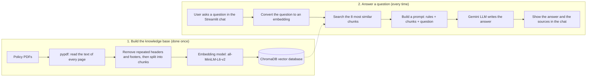

# 🛡️ Insurance Policy Assistant (RAG Chatbot)

A chatbot that answers questions about insurance policy documents. It answers **only from the documents** and shows the **source file and page** for every answer. If the answer is not in the documents, it says so instead of guessing.

**Live demo:** _add your Streamlit link here_

## Screenshots

| Welcome screen | Answer with sources | Out-of-scope question refused |
|---|---|---|
|  |  |  |

## What problem does it solve?

Insurance policy documents are long (this project uses 4 PDFs, 119 pages) and full of legal wording. Finding one fact, such as a waiting period or the documents needed for a claim, takes time. This chatbot lets a user ask in plain English and get a short answer with proof from the original page.

## Features

- Answers in simple English, using only the policy documents
- Shows the source file, page number and original text for every answer
- Refuses questions that are not in the documents (for example, "What is the capital of France?")
- Clickable sample questions, chat history and a clear-chat button
- Automatic fallback to another Gemini model and a time limit when the AI service is busy

## How the project runs



### Step by step

**Part 1: Build the knowledge base (done once)**
1. **Read:** `pypdf` extracts the text from every page of each PDF.
2. **Clean:** lines that repeat on many pages (page headers and footers) are removed, so they do not add noise to the search.
3. **Chunk:** the text is split into pieces of about 1000 characters, with 150 characters of overlap so no sentence is lost at the edges. Each chunk keeps its file name and page number.
4. **Embed:** the `all-MiniLM-L6-v2` model turns each chunk into 384 numbers that represent its meaning.
5. **Store:** the chunks and their embeddings are saved in ChromaDB.

**Part 2: Answer a question (every time)**
1. The user types a question (or clicks a sample question).
2. The question is turned into an embedding with the same model.
3. ChromaDB returns the 8 chunks with the closest meaning. This is called **retrieval**.
4. A prompt is built from three parts: the rules, the 8 chunks as context, and the question.
5. The Gemini model writes the answer. The rules tell it to use only the context, to summarize partial information and say what is missing, and to reply "I could not find this in the policy documents." when nothing relevant is found.
6. The app shows the answer, the sources and the model used.

## Tools used and why

| Tool | What it does in this project | Why I chose it |
|---|---|---|
| **Python** | Language for the whole project | Standard language for AI and data work, with libraries for every step |
| **pypdf** | Reads text from the PDF files | Free, simple, and works well on text-based PDFs |
| **Custom chunking code** | Cleans headers and splits text into chunks | An LLM cannot read 119 pages per question. Small chunks keep the search focused, and the overlap keeps sentences whole. Cleaning headers fixed three questions that failed in my first test |
| **sentence-transformers (all-MiniLM-L6-v2)** | Turns text into embeddings | Free, runs on my own computer, small and fast, and needs no API key or cost |
| **ChromaDB** | Vector database that stores and searches embeddings | Easy to set up locally with no server. It stores metadata (file and page) next to each chunk, so I can show sources |
| **Google Gemini API (Flash models)** | The LLM that writes the final answer | Has a free tier, is fast, and follows instructions well. The code tries backup models if one is busy |
| **Prompt rules (guardrails)** | Tell the LLM to answer only from the context | Reduces hallucination (made-up answers), which matters for insurance |
| **Streamlit** | The chat web page | Builds a web interface with plain Python, so I could focus on the AI part |
| **config.py** | Reads the API key from `.env` or the server settings | Keeps the secret key out of the code and out of GitHub |
| **Git and GitHub** | Version control and code hosting | Needed to share the project and to deploy it |
| **Streamlit Community Cloud** | Free online hosting | Deploys directly from GitHub, so anyone can open the app by a link |

## Evaluation

I tested the chatbot with 15 questions:

- **10 in-scope questions** (waiting period, free look period, claim documents, grace period, exclusions, death benefit, critical illness, hospitalization and others)
- **5 out-of-scope questions** (for example the capital of France, or the best insurance company)

| Result | Score |
|---|---|
| In-scope questions answered | 10 / 10 |
| In-scope answers verified correct by hand against the PDFs | _fill in: X / 10_ |
| Out-of-scope questions correctly refused | 5 / 5 |

**What I learned from testing:** my first run answered only 7 of 10 questions. When I inspected the search results, I found that every chunk began with the same repeated page header, which added noise. After I removed the headers and made the prompt rule less strict for partial information, all 10 were answered and the 5 out-of-scope questions were still refused.

## Limitations and future improvements

- The small embedding model sometimes misses a relevant chunk. Improvement: hybrid search (keyword plus meaning) or re-ranking.
- Tables and scanned pages are not read well. Improvement: OCR and table extraction.
- Only 4 documents are loaded. Improvement: let users upload their own PDFs.
- The test set is small (15 questions). Improvement: a larger test set with automatic scoring.
- This is a demo with public documents. It is not insurance advice.

## Project structure

```
Insurance-Rag/
├── app.py            # Streamlit chat interface
├── rag.py            # Core logic: retrieval, prompt, Gemini call, fallback
├── config.py         # Reads the API key safely
├── chunk.py          # Reads PDFs, cleans headers, creates chunks.json
├── embed.py          # Creates embeddings and fills ChromaDB
├── check_pdfs.py     # Checks that the PDFs are readable
├── chat.py           # Terminal version for quick tests
├── test.py           # Runs the 15-question evaluation
├── debug_search.py   # Shows what the search returns
├── chunks.json       # The chunks (used to rebuild the database)
├── eval_results.csv  # Results of the 15-question test
├── data/             # The policy PDFs
└── requirements.txt  # Libraries to install
```

## Run it on your computer

```bash
git clone https://github.com/Sreedharan1998/insurance-policy-rag-chatbot.git
cd insurance-policy-rag-chatbot

python -m venv venv
venv\Scripts\activate          # Windows  (Mac/Linux: source venv/bin/activate)
pip install -r requirements.txt
```

Create a file named `.env` in the project folder with one line (get a free key at aistudio.google.com):

```
GEMINI_API_KEY=your_key_here
```

Then start the app:

```bash
streamlit run app.py
```

The first start takes a few minutes, because the app builds the vector database from `chunks.json`. To rebuild the chunks from the PDFs, run `python chunk.py` and then `python embed.py`.

## Deployment

The app is deployed on Streamlit Community Cloud from this repository. The API key is stored in the platform's secrets settings and is never committed to GitHub.

## Disclaimer

This is a learning project using public policy documents. It is not insurance, legal or financial advice.
